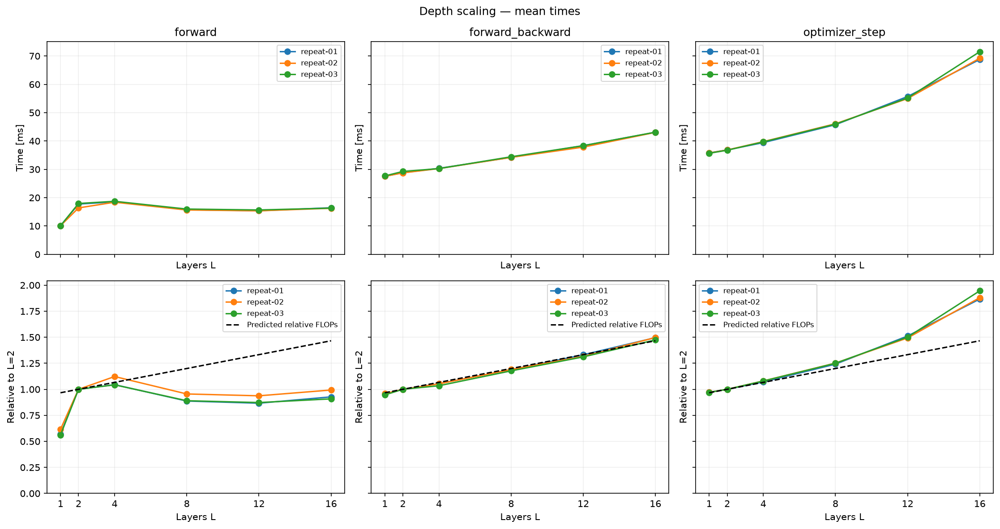

# LLM Systems Lab

My learning project: building a GPT in PyTorch and checking how its size,
attention implementation and batch shape affect time and memory.

## What is implemented

- GPT from scratch, with naive attention and optional SDPA
- Training, single-batch overfitting and text generation
- Hugging Face GPT-2 weight import
- Synthetic time and memory benchmarks, with plots in notebooks

## Where things are

```text
src/llm_systems_lab/   model, data and config code
scripts/training/     train, overfit and plot training metrics
scripts/inference/    generate text
scripts/benchmarks/   measure time/memory and draw plots
configs/              settings for training and benchmarks
experiments/          saved results, notebooks and figures
```

Setup: `uv sync --locked`. For notebooks, use the repo's `.venv/bin/python`.

## Model anatomy

The model consists of token embeddings, positional embeddings, causal
self-attention, MLP blocks, residual connections, and LayerNorm.

## Parameter count

$$
N = VD + CD + L(12D^2 + 13D) + 2D
$$

$V$: vocabulary, $D$: width, $C$: context limit, $L$: layers.
Embedding and LM head share weights, so $VD$ is counted once.
Tiny baseline: 6,862,464 parameters. GPT-2 reference: 124,439,808.

## Compute model

Counting a multiply-add as two FLOPs:

$$
F_{\text{block}} \approx 24BTD^2 + 4BT^2D
$$

$$
F_{\text{lm-head}} \approx 2BTDV
$$

$$
F_{\text{forward}}
\approx
L(24BTD^2 + 4BT^2D) + 2BTDV
$$

$B$: batch size, $T$: sequence length. This counts the main matmuls, not
softmax, normalization or loss. More FLOPs do not always mean more runtime.
With our tiny model and large vocabulary, the LM head dominates this estimate.

## Experiments

- [Depth scaling](experiments/01_depth_scaling/analysis.ipynb): L=1–16, predicted FLOPs vs measured time.
- [Memory](experiments/02_memory_scaling/analysis.ipynb): doubling batch size or sequence length.
- [Naive vs SDPA](experiments/03_attention/analysis.ipynb): time and memory, including longer sequences and forward with/without autograd.
- `scripts/benchmarks/roofline.py`: small GEMM and copy measurements for a hardware reference.

Times measured on MPS in FP32, three repeats each. SDPA uses the math backend
with autograd in our setup. JSONs are in `experiments/`; checkpoints and scratch
runs stay in ignored `artifacts/`. CUDA preparation is present, but CUDA results
have not been measured yet.



The depth notebook saves mean and median plots in its `figures/` folder.
The [inference plotting script](scripts/benchmarks/plot_inference.py) will do the same
for the next experiment, alongside a small CSV table.

## Next

1. [KV cache](experiments/04_kv_cache/README.md): implement cached forward in GPT,
   then compare prefill/decode time and cache size as the context grows.
   The no-cache benchmark is ready; cached forward is still to do.
2. Compare a cache that grows with `torch.cat` against a preallocated buffer:
   how much time do allocations and copies add?
3. Try a small LLaMA-like model: RoPE, RMSNorm and SwiGLU, then GQA to explore
   fewer K/V heads and a smaller cache. This is a future implementation.

For training, the next useful comparison is different microbatches at the same
effective batch size, followed by activation checkpointing.
CUDA profiling tools are ready for a later GPU session.

## Learning resources

I am currently working through:

- [How to Scale Your Model](https://jax-ml.github.io/scaling-book/)
- [Ultra-Scale Playbook](https://huggingface.co/spaces/nanotron/ultrascale-playbook)
- [Andrej Karpathy's lectures](https://www.youtube.com/@AndrejKarpathy)

## Acknowledgements

This project is inspired by GPT-2, nanoGPT, and educational materials by
Andrej Karpathy.
