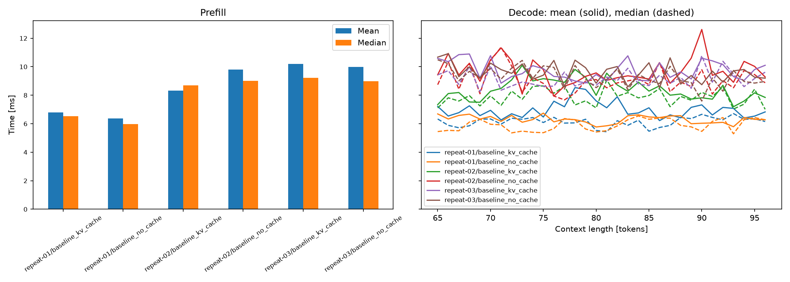

# KV cache: prefill and decode

Does reusing K/V change the result, and what happens to decode time?

`GPT.forward_cached` returns last-token logits and a list of `(K, V)` pairs, one per layer,
with shape `[B, H, cached_length, head_dim]`. Positions continue from the cached
prefix; during one-token decode, the query can see every stored key.
Prefill runs the prompt once. Each later call supplies one new token. Use eval mode
and disabled gradients. The cache is passed explicitly, not stored in the model.

The first version grows with `torch.cat`. It is deliberately simple; appending
copies old K/V. Fixed buffers and TTNN trace are not implemented here.

## Correctness

Small CPU and MPS checks cover naive attention and SDPA: prefix logits, greedy
tokens, projected K/V contents, a fresh shorter request and the context boundary.
They also check inference-only use and unchanged checkpoint keys/ordinary outputs.
The reports are in `results/correctness/`. Logits use rtol=1e-4, atol=1e-5.
Ordinary and checkpointed training gradients agree within those tolerances;
MPS showed differences around 7e-9, also seen in repeated unchanged-model backward runs.

Each cached benchmark repeats prefix-logit and greedy-token checks before timing.
This verifies finite examples, not all inputs or bitwise equality across devices.

## Run

From the repo root:

```bash
uv run python scripts/benchmarks/inference.py \
    --config configs/benchmarks/inference/baseline.toml \
    --output experiments/04_kv_cache/results/repeat-01/baseline_no_cache.json
```

`baseline` uses a 64-token prompt. `p32` and `p128` change only its length.
Each run has 3 warmup sequences and 10 measured sequences, with 32 decode calls.
Use a new filename for each run. Add `--mode kv_cache` and
save as `baseline_kv_cache.json`; the script compares logits and greedy tokens before timing.

Both modes use the same synthetic continuation and random weights.
Prefill processes the prompt; decode consumes one supplied token per call.
Tokens/s counts the whole batch and excludes prefill. Cache MiB is the final
size of K/V tensors. It does not include weights or temporary allocations.

For this model:

$$
M_{\text{KV}} = 2LBHT_{\text{cached}}d_{\text{head}}s
$$

The factor 2 is K plus V; s is bytes per element. With L=2, B=1, H=4,
96 cached tokens, head width 32 and FP32, this is 196,608 bytes = 0.1875 MiB.

## Result

M4 / MPS / PyTorch 2.14.0 / FP32 / naive attention. D=128, L=2, H=4,
V=50257, B=1. The prompt has 64 tokens; 32 supplied tokens follow it.
Three fresh-process repeats per mode, 3 warmups and 10 measured sequences each.
Mode order was no-cache/cache, cache/no-cache, no-cache/cache. AC power; no
other project checks ran during the selected timing series.

| Repeat | No cache mean [ms] | No cache median [ms] | KV cache mean [ms] | KV cache median [ms] |
|---|---:|---:|---:|---:|
| 1 | 6.30 | 5.90 | 6.98 | 6.30 |
| 2 | 9.67 | 8.89 | 8.41 | 7.72 |
| 3 | 9.61 | 9.14 | 9.74 | 9.12 |

These are decode times per batch step, not total generation time. Cached logits
differed by at most 5.37e-7 and greedy tokens matched. The final cache was 0.1875 MiB.
Prefill and throughput are included in the notebook and `figures/summary.csv`.

There is **no consistent speedup** in this tiny, short-context case. Both paths
vary between runs. Concatenation adds copying and the LM head remains in both
paths, but we have not profiled the cause of the timing differences.
Prefill timing excludes tokenization and request handling, so it is not service TTFT.



The first timing series overlapped CPU validation. Its raw samples were preserved
in ignored `artifacts/benchmarks/inference/initial-overlap/`; the table above uses
the subsequent series collected after validation finished.

## Plot

```bash
uv run python scripts/benchmarks/plot_inference.py \
    experiments/04_kv_cache/results/repeat-*/baseline_*.json \
    --output-dir experiments/04_kv_cache/figures
```

Compare the same model, prompt length, batch size and device.
This saves `latency.png`, `throughput.png` and `summary.csv`.
The notebook and exporter share `llm_systems_lab.inference_results`; the CSV keeps
the source file, model dimensions and measurement settings alongside the timings.
The notebook is there for exploring the individual measurements.
## Things to explain

> **Recall:** Why are K and V reusable, but not Q? Why do old states remain valid in a causal model?

> **Recall:** What position does the decode query occupy, and which keys may it see?

> **Recall:** Why does growing a cache with concatenation still move data? How would fixed buffers change that?

The [Tenstorrent workshop](https://github.com/mdragulaTT/cache-me-if-you-can) covers the
same mechanisms, then explores fixed caches, fusion and trace. This repo stays in
PyTorch/MPS; workshop code and Tenstorrent measurements are not our results.
