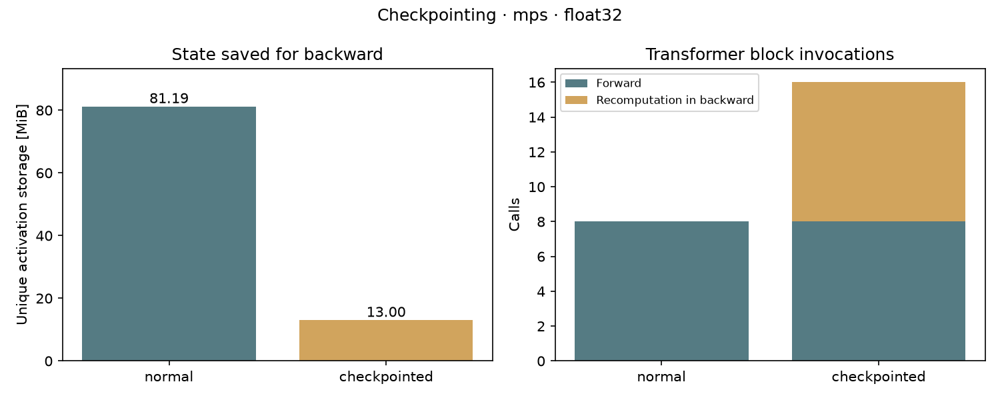
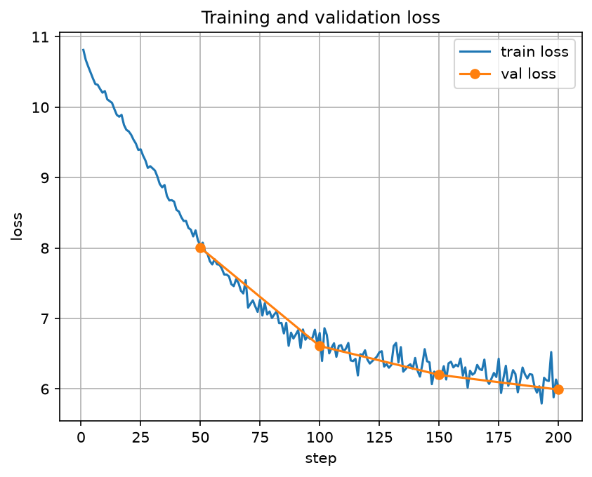

# Training memory

Can we save less for backward without changing the training step?

## Controlled case

M4 / MPS / FP32 / naive attention. B=4, T=128, D=256, L=8, H=4, V=4096.
Same starting weights and synthetic tokens, one AdamW step per case.

| | Normal | Checkpointed |
|---|---:|---:|
| Saved activation storage [MiB] | 81.19 | 13.00 |
| Block entries in forward | 8 | 8 |
| Block entries in backward | 0 | 8 |

About **84% less saved activation storage**. Loss, gradients and updated weights
matched at the same batch size. Checkpointing saves block inputs and recomputes
intermediate tensors in backward instead of keeping them all from forward.



The script counts unique storage saved by autograd, excluding existing weights,
buffers and batch tensors. Tensor views sharing storage count once. **This is not
peak GPU memory.** Block entries show recomputation, not its exact FLOPs or time.

We also checked accumulation with microbatch=1. FP32 gradients differed by at
most `1.64e-7`, but updated weights differed by `5.63e-5`: AdamW can amplify
rounding near zero gradients. The CPU float64 update difference was `3.57e-14`.
Checkpointed microbatches also matched ordinary microbatches.

To rerun the check, use a new output path (existing JSONs are protected):

```bash
uv run python scripts/training/check_training_memory.py --device mps --output artifacts/training_memory/mps.json
uv run python scripts/training/check_training_memory.py --device cpu --dtype float64 --output artifacts/training_memory/cpu_fp64.json
```

## Real training run

200 steps on Shakespeare, effective B=8, microbatch=2, T=128, D=128, L=2, V=50257.
Checkpointing was enabled. This checks the training pipeline, not text quality.

Train loss: **10.81 → 6.04**. Validation loss: **8.01 at step 50 → 5.99 at step 200**.
All 200 metric rows are saved in `results/shakespeare_metrics.jsonl`.
The greedy generation example is saved in `results/generation.json`; it repeats
newlines, so this short run has not produced useful text yet.



Config: [gpt_tiny_checkpointing.toml](../../configs/gpt_tiny_checkpointing.toml).
After preparing the Shakespeare data, run:

```bash
uv run python scripts/training/train.py --config gpt_tiny_checkpointing.toml
```

Change `[run].name` if that run folder already exists. Checkpoints stay in `artifacts/`.

## Redraw the figures

These commands use saved results only, without training or a GPU:

```bash
uv run python scripts/training/plot_training_memory.py experiments/05_training_memory/results/mps.json --output experiments/05_training_memory/figures/checkpointing.png
uv run python scripts/training/plot_train_metrics.py --metrics experiments/05_training_memory/results/shakespeare_metrics.jsonl --output-dir experiments/05_training_memory/figures/training
```

For the code walkthrough, start with `GPT.forward`, then `run_step` in
`scripts/training/check_training_memory.py`. The [recall questions](spec.md)
cover the main things to understand before discussing this experiment in an interview.
